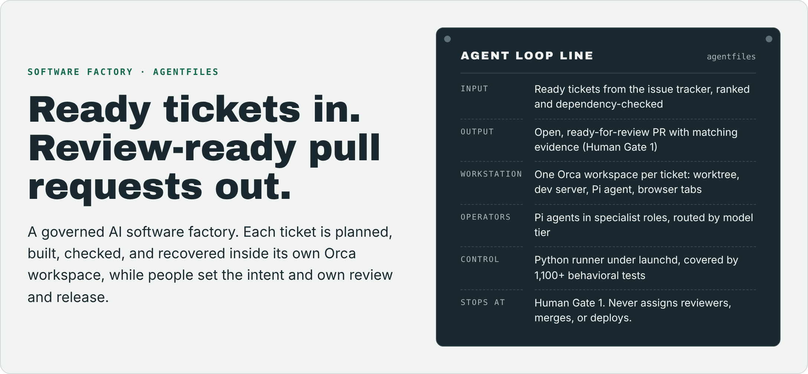
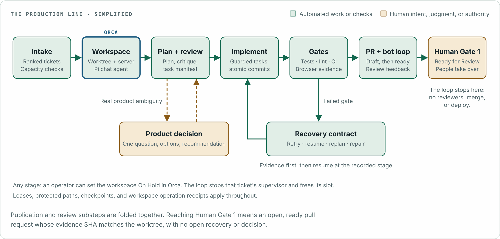
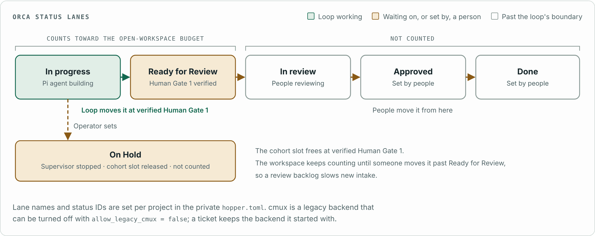
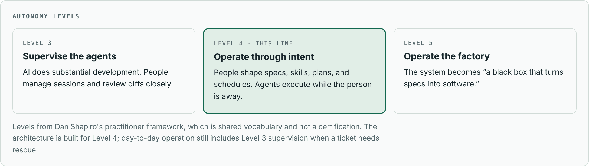

# agentfiles

One tool-neutral source of truth for AI agent-orchestration config -- agent
roles, skills, hooks, and MCP servers -- usable by **Claude Code, Codex CLI,
and pi**. It also ships an optional [Software Factory](#software-factory): an agent loop
that takes ready tickets to review-ready pull requests, one Orca workspace per ticket.

## What it is

`agentfiles` keeps reusable orchestration content in `common/` and tool-native
setup and rendering rules in `tools/`. It materializes selected
framework-managed artifacts for `~/.claude`, `~/.codex`, and `~/.pi/agent`
without creating another policy fork for private or package-owned overrides.

## Why

If you use more than one agentic CLI, you've felt this: an agent definition
gets tuned in one tool and the other quietly falls behind. `agentfiles`
keeps reusable framework content in `common/` plus native `tools/` overlays.
Private organization overrides and externally owned packages retain their own sources;
resolve ownership before comparing or synchronizing installed artifacts.

## Software Factory

<picture>
  <source media="(prefers-color-scheme: dark)" srcset="docs/software-factory/img/banner-dark.png">
  
</picture>

The optional [agent loop](common/skills/agent-loop/README.md) runs this framework as a
**governed AI software factory**: automated orchestration and bounded recovery between a
human-chosen intake and a human review boundary. Each admitted ticket is planned, built,
checked, and recovered inside its own [Orca](https://github.com/stablyai/orca) workspace.
People set the intent and own review, merge, and release.

### One ticket, one workspace, one line

<picture>
  <source media="(prefers-color-scheme: dark)" srcset="docs/software-factory/img/line-dark.png">
  
</picture>

Every admitted ticket follows the same stages:
`spinup → plan → plan-review → implement → gates → draft-pr → ready → bot-loop → human-gate-1`.

- **Failures become recovery contracts.** Each failure records its evidence first, then a
  structured contract (task retry, stage resume, republish, replan, spinup retry, or provider
  wait) that the reconciler consumes. Nothing resumes from a guess.
- **Only real product questions reach a person.** A decision wait needs the sources checked,
  materially different options, a recommendation, and one question.
- **The line stops at Human Gate 1:** an open, ready-for-review pull request whose evidence SHA
  matches the worktree, with no open recovery or decision. The loop never assigns reviewers,
  merges, or deploys.

### The factory floor is an Orca board

<picture>
  <source media="(prefers-color-scheme: dark)" srcset="docs/software-factory/img/floor-dark.png">
  
</picture>

Each ticket's Orca workspace holds a worktree cut from `origin/main`, a setup terminal, a dev
server, a Pi agent in an Orca chat session, and reference and app browser tabs. The status lanes
are the hand-off surface between people and the loop.

- **Ready for Review is earned.** The loop moves a workspace there only after Human Gate 1 is
  verified. People move it from there.
- **On Hold hands a ticket back.** The loop stops that ticket's supervisor and frees its cohort
  slot.
- **A review backlog slows intake.** `workspace.max_open` counts workspaces that are in progress
  or awaiting review.
- **Every workspace action leaves a receipt.** Worktree creation, setup, dev server, and agent
  launch are recorded in a per-ticket binding. After a restart the loop inspects what exists
  instead of replaying an uncertain step, so it cannot spawn a second agent.
- **Liveness comes from Orca, not the UI.** Agents are confirmed by their durable Orca session ID
  and dev servers by a running terminal plus an HTTP probe.

cmux remains a legacy backend; set `allow_legacy_cmux = false` in `hopper.toml` to run Orca-only.

### Stations on the line

| Station | What runs there | Status |
| --- | --- | --- |
| Intake & admission | The drip pulls ranked, ready issue-tracker work and checks dependencies. Admission checks machine pressure (memory compression, load, disk), cohort capacity, and the Orca open-workspace budget. | Running |
| Workstations | One Orca workspace per ticket: an exactly named worktree, setup and dev-server terminals, a Pi agent, and browser tabs. Optional tabs never block a launch. | Running |
| Workspace identity | A per-ticket binding records backend, worktree, terminals, agent session, and views. A recorded binding never changes backend. | Running |
| Work instructions | An evidence-backed plan, a plan review, a bounded task manifest with explicit dependencies, skills, and a definition of done. | Running |
| Specialist roles | Tool-neutral [agent definitions](common/agents/) for authoring, critique, task writing, implementation, review, adjudication, repair, and QA, each mapped to a tier in [`model-tiers.toml`](common/model-tiers.toml). | Running |
| Quality control | Target-repo tests, lint, builds, browser evidence, and CI. The runner executes verification itself, and a rejecting guard is rerun on the base tree before an attempt is charged. | Running |
| Recovery | Evidence first, then a structured recovery contract. Runner defects go to test-first repair with independent review. | Running |
| Governance | Protected paths, a private config that fails closed, foreground ownership for direct work, On Hold hand-back, and no reviewer assignment, merge, or deploy. | By design |
| Visibility | Orca status lanes, an unread flag when the loop needs a person, and on-demand `runner.py overview` and `watch --once` snapshots. Nothing polls on a timer. | Running |
| Economics | Pre-implementation, premium, and unattended budgets; a usage ledger; per-stage metrics. | Instrumented; needs outcome analysis |
| Independent acceptance | A protected holdout scenario suite the implementing agent cannot redefine. | Next to build |
| Production feedback | A loop that turns incidents and customer outcomes into new checks. | Next to build |

"Running" means built and in use, not that every ticket clears that station without help.

### Where it sits

<picture>
  <source media="(prefers-color-scheme: dark)" srcset="docs/software-factory/img/levels-dark.png">
  
</picture>

"Software factory" covers two operating models. This line is a **governed** factory: like
[AWS AI-DLC](https://aws.amazon.com/blogs/devops/open-sourcing-adaptive-workflows-for-ai-driven-development-life-cycle-ai-dlc/),
[GitHub Spec Kit](https://github.blog/ai-and-ml/generative-ai/spec-driven-development-with-ai-get-started-with-a-new-open-source-toolkit/),
[Continuous AI](https://github.blog/ai-and-ml/generative-ai/continuous-ai-in-practice-what-developers-can-automate-today-with-agentic-ci/),
and [Microsoft's agentic platform](https://developer.microsoft.com/blog/learn-from-microsoft-transform-software-development-through-an-agentic-platform/),
it keeps human decision gates. A **dark** factory, as
[StrongDM describes it](https://factory.strongdm.ai/), removes routine human coding and code
review and relies on external scenario validation
([Simon Willison's account](https://simonwillison.net/2026/Feb/7/software-factory/)). This line
keeps human review on purpose. The levels come from
[Dan Shapiro's five-level framework](https://www.danshapiro.com/blog/2026/01/the-five-levels-from-spicy-autocomplete-to-the-software-factory/),
which is shared vocabulary, not a certification.

### What's next: proving yield

1. **Measure.** Run a consecutive batch and count: share reaching Human Gate 1 without rescue,
   human minutes per accepted ticket, median and slow-tail lead time, total cost including failed
   attempts, and rework after review. On Hold hand-backs are already recorded as
   `operator-on-hold`, so interventions are countable.
2. **Accept independently.** Add a protected scenario suite the implementing agent cannot
   redefine.
3. **Harden.** Show that recurring rescue classes stop recurring, with the original failing gate
   passing on an exact verification receipt.
4. **Prove unattended.** Routine failures resolve while the operator is away, and real product
   questions arrive with useful evidence.

Raising capacity or removing safeguards is a separate decision. A dependable factory can keep
people in charge of release.

### Run your own line

1. Read the [agent-loop operator guide](common/skills/agent-loop/README.md) and the
   [operations policy](common/skills/agent-loop/references/operations-policy.md).
2. Install the prerequisites: Python 3.11+, pi 1.3.0+ with `pi-subagents`, Node.js, Git, GitHub
   CLI, issue-tracker access, and model-provider access.
3. Install [Orca](https://github.com/stablyai/orca) with its CLI on `PATH` (`orca`, or `orca-ide`
   on Linux) and register your app checkout. Before creating anything, the runner checks that Orca
   is reachable, the repo matches, and the Orca build reports the capabilities the adapter needs.
4. Create the private `hopper.toml` (see
   [Agent loop local configuration](#agent-loop-local-configuration)) and set
   `project.configured = true`.
5. Inspect before you run anything that writes:

   ```bash
   R="<agentfiles checkout>/common/skills/agent-loop/scripts"
   python3 "$R/runner.py" overview
   python3 "$R/runner.py" drip --dry-run
   ```

A real `drip` creates Orca workspaces and starts agents, so start with one supervised ticket. The
Orca adapter's dev-server probe assumes `bin/dev` under overmind, a `PORT` in `.env`, and a
per-ticket local `.test` hostname; adapt those pieces for other apps.

<details>
<summary><strong>The engine, by responsibility</strong></summary>

All modules live in [`common/skills/agent-loop/scripts/`](common/skills/agent-loop/scripts/). The
operator entry point is `runner.py`.

| Responsibility | Modules | Role |
| --- | --- | --- |
| Operator entry | `runner.py`, `lifecycle.py` | Operator commands and dispatch; advancing a ticket through its persisted stages. |
| Workspaces | `workspaces.py`, `workspace_orca.py`, `workspace_cmux.py`, `workspace_binding.py`, `workspace_capacity.py` | Backend selection and receipt-based launch, the Orca and legacy cmux adapters, per-ticket bindings, and the status-based workspace budget and On Hold detection. |
| Config & records | `config.py`, `state.py`, `attempt.py` | Load the private `hopper.toml`; keep ticket and attempt records that make interrupted work recoverable. |
| Planning & contracts | `plan.py`, `contracts.py`, `agentdef.py` | Plans and plan review, task manifests and worker results, and Pi agent definitions. |
| Implement & verify | `ladder.py`, `guards.py`, `worktree.py` | Worker escalation, verification soundness, snapshots, and allowed-file boundaries. |
| Intake & capacity | `drip.py`, `admission.py`, `cohort.py` | Select eligible work, check machine pressure, track cohort slots, and honor On Hold hand-backs. |
| Recovery | `reconcile.py`, `heal.py`, `recovery.py`, `review_reconcile.py` | Reconcile interrupted attempts, apply reason-specific healing, and keep explicit recovery contracts. |
| Runner repair | `repair.py` | Turn runner defects into test-first, independently reviewed repairs. |
| Decisions & ownership | `decision.py`, `interactive.py` | Validate real product questions and keep foreground work separate from the cohort. |
| CI & review | `ci.py`, `botreview.py` | Classify CI results and turn bot review feedback into scoped follow-up work. |
| Publication | `publish.py`, `prbody.py`, `screenshots.py` | Publish accepted changes, write PR descriptions, and capture screenshots. |
| Process safety | `supervise.py`, `providers.py`, `locks.py`, `procid.py`, `procs.py` | launchd supervision, provider availability, ownership leases, process identity, and bounded subprocesses. |
| Visibility & spend | `watch.py`, `sidebar.py`, `budget.py`, `ledger.py`, `metrics.py` | Ticket snapshots, workspace presentation and review routing, spend, usage, and stage metrics. |
| Advanced & test-only | `parallel.py`, `cohort_migration.py`, `fake_worker.py` | Intra-ticket parallelism (gated off), cohort migration, and a simulated worker for tests. |
| Regression evidence | `test_*.py` | Behavioral tests for contracts, lifecycle, recovery, ownership, workspaces, and publication. |

</details>

The images come from [`docs/software-factory/index.html`](docs/software-factory/index.html), a
standalone version of this overview. Edit it, then run `python3 docs/software-factory/render.py`
to regenerate the light and dark images.

## Quick start

Pick your tool and run the one-liner. It clones (or updates) this repo to
`~/.agentfiles` and has your tool's own AI execute that tool's setup steps.

**Claude Code:**

```bash
curl -fsSL https://raw.githubusercontent.com/crstamps2/agentfiles/main/bootstrap.sh | bash -s -- --tool=claude
```

**Codex CLI:**

```bash
curl -fsSL https://raw.githubusercontent.com/crstamps2/agentfiles/main/bootstrap.sh | bash -s -- --tool=codex
```

**pi:**

```bash
curl -fsSL https://raw.githubusercontent.com/crstamps2/agentfiles/main/bootstrap.sh | bash -s -- --tool=pi
```

**Clone-and-run alternative** (if you'd rather inspect the script first, or
already have a checkout):

```bash
git clone https://github.com/crstamps2/agentfiles.git
cd agentfiles
./bootstrap.sh --tool=claude   # or --tool=codex, --tool=pi
```

## Layout

```
common/                   # Shared tool-neutral source, edit framework content here
  instructions/AGENTS.md  # Orchestration rules, role boundaries, conventions
  agents/*.agent.md       # Agent role definitions (tool-neutral frontmatter)
  skills/                 # Orchestration skills (agent-loop, loop-watch, standup, retro, audit, spinup, spindown)
  hooks/                  # Shared and harness-scoped scripts + hooks.manifest.jsonc
  mcp/servers.jsonc       # MCP server catalog
  model-tiers.toml        # Tier -> concrete model, per tool
  scripts/agentfiles-scan.sh  # Deny-list + secret scan for public pushes

docs/software-factory/    # Software Factory overview page, README images, render script

tools/
  claude/setup.md         # Ownership-aware setup and native Claude rules
  codex/setup.md          # Ownership-aware setup and native Codex rules
  pi/setup.md             # Ownership-aware setup and native pi rules
  pi/extensions/          # pi extensions that reproduce hooks on pi's event API
  claude/plugins/         # Local Claude plugin marketplace (example: LSP)
  codex/openai.yaml.tmpl  # Template for per-skill Codex metadata

bootstrap.sh              # Entry point: resolve env, sync repo, dispatch setup
```

Only selected framework-managed artifacts under harness roots are derived output. Before
changing a destination, setup resolves links and registrations: missing or confirmed
framework-managed entries can converge to the documented source; private overrides,
package/shared-marketplace content, personal configuration, runtime memory, and uncertain
owners are preserved and reported.

A preserved external entry is not a setup failure to "fix" by repointing it. If a requested
change needs to replace one, setup stops that entry for explicit migration approval. Host
dotfiles should wire external owners, not maintain another policy fork.

Claude Code's user-global entry point is `~/.claude/CLAUDE.md`; native
`AGENTS.md` discovery covers project paths, not that scope. Claude setup
therefore symlinks that entry point to `common/instructions/AGENTS.md`, keeping
one content source rather than a second instructions copy.

## How it works

1. **`bootstrap.sh` resolves the environment.** It figures out `$HOME`, the
   clone directory (default `~/.agentfiles`, override with `--home=` /
   `--repo=`), and the OS (`macos`/`linux`), then clones or `pull --ff-only`s
   the repo.
2. **It dispatches to the tool's own AI.** `bootstrap.sh --tool=<claude|codex|pi>`
   invokes that CLI with an instruction to read and mechanically execute
   `tools/<tool>/setup.md` -- the CLI configures itself using its own
   filesystem/shell access, with `AF_HOME`, `AF_REPO`, and `AF_OS` injected
   as environment variables. (pi is invoked in non-interactive print mode,
   `pi -a -p`.)
3. **Setup is ownership-aware and symlink-first where native formats permit.**
   For a missing or confirmed framework-managed destination, eligible shared
   instructions and skills can symlink directly from `common/`; an external
   same-name target is preserved and reported instead of repointed. Native
   overlays render artifacts when the destination format differs. For example,
   Codex skills with unsupported generic frontmatter render only supported
   frontmatter while retaining the source body, and agent definitions
   (`common/agents/*.agent.md`) render to each tool's native agent format:
   Claude uses `.md` with `model:`, Codex uses `.toml` with `model` /
   `model_reasoning_effort`, and pi uses `.md` with `model` / `thinking` read
   by `pi-subagents`. Setup regenerates only ownership-verified generated
   renders, looking up each agent's `tier:` in `model-tiers.toml`. See
   `tools/claude/setup.md`, `tools/codex/setup.md`, and `tools/pi/setup.md`
   for the exact transform rules.

**Note on pi.** Setup requires pi 1.3.0 or later with **built-in MCP**. Delegation
uses `pi-subagents`, and the vendored `agentfiles-hooks` extension maps shared hooks
onto pi events. No MCP adapter package is required. An extension registering `/mcp`
replaces the builtin; setup stops for a separately approved migration if one is found.
Instructions and supported skill formats use native context-file/Agent-Skills support.
The MCP renderer applies conservative checks to the catalog forms it supports before
creating a missing file; the installed pi release remains authoritative, and this does
not promise complete support for future native schemas.

## Updating

Re-run the same one-liner (or `git -C ~/.agentfiles pull --ff-only &&
~/.agentfiles/bootstrap.sh --tool=<claude|codex|pi>` if you cloned manually).
Bootstrap is repeatable for entries it owns: selected framework-managed links
converge, ownership-verified generated renders regenerate in place, and approved
hook/MCP operations do not duplicate entries. It preserves external or uncertain
targets and reports any needed migration for approval, so a rerun can stop with an
approval-required outcome rather than materializing every similarly named artifact.

## Agent loop local configuration

The optional agent loop has a public template and a private runtime configuration. After bootstrap,
create the ignored local configuration manually from the tracked sample:

```bash
cd "<agentfiles checkout>/common/skills/agent-loop"
cp -n hopper.example.toml hopper.toml
```

Complete `hopper.toml` with project-specific repository, issue tracker, operator, worktree, and
operational settings before running the loop. The runner loads only `hopper.toml` and fails closed
when it is missing or invalid; it never runs the example automatically. Keep tokens and credentials
in environment variables or the approved credential store, never in either hopper file. See the
[agent-loop operator guide](common/skills/agent-loop/README.md) for required configuration and
operating safeguards.

## Supported platforms & prerequisites

- **macOS or Linux.** `bootstrap.sh` detects the OS via `uname` and adjusts
  symlink/copy syntax accordingly; there's no behavior difference otherwise.
- **`git`**, to clone/update the repo.
- **One of the CLIs**: [Claude Code](https://docs.anthropic.com/en/docs/claude-code),
  [Codex CLI](https://github.com/openai/codex), or [pi](https://pi.dev),
  reachable on `$PATH` as `claude`, `codex`, or `pi` respectively (bootstrap
  invokes it directly).
- **For pi:** pi 1.3.0 or later and Node.js; delegation setup may install
  `pi-subagents` on first run. MCP itself is built in, not an adapter dependency.

## Customizing

Shared framework content belongs under `common/`; native setup, rendering, and
integration behavior belongs under `tools/`. A tool picks up selected
framework-managed outputs on the next `bootstrap.sh` run. Private, package-owned,
and other external artifacts retain their native owner and are not source-edit targets.

**Add or edit an agent** -- create/edit `common/agents/<name>.agent.md`.
Frontmatter needs at minimum `name:`, `description:`, and `tier:` (one of
the tables in `model-tiers.toml`); `access:` is optional and lists the
tools the agent may use. The body (below the closing `---`) is the agent's
system prompt/instructions, copied verbatim into every tool's rendered
output.

**Add or edit a skill** -- create a new directory under `common/skills/<name>/`
with a `SKILL.md`. Each setup selects only ownership-verified destinations, then
uses a direct link or the tool's documented native rendering. It does not repoint an
external same-name skill.

**Add or edit a hook** -- drop a script under `common/hooks/`, then add an
entry for it in `common/hooks/hooks.manifest.jsonc` under the relevant event
key (`SessionStart`, `Stop`, etc.). Entries are shared by default; add an
optional `tools` array such as `"tools": ["pi"]` when a hook depends on one
harness's native registry or configuration. Each setup path skips entries that
do not select its harness and rejects malformed selectors rather than widening
their scope. Each setup maps only events with a verified native semantic
equivalent and reports unsupported events instead of approximating them. Claude
Code merges its supported entries; Codex 0.164 maps `SessionStart` but skips the
shared end-of-turn `Stop` because `SessionEnd` is not equivalent. pi runs eligible
entries via the `agentfiles-hooks` extension, which maps `SessionStart`/`Stop`
onto pi's event API (extend that extension only after verifying native semantics
for additional events).

The Pi-only `model-route-check.sh` hook validates active model routes against
`pi --list-models` at session start. Its default mode is advisory so registry
unavailability does not block startup. Run `common/hooks/model-route-check.sh --strict`
in setup, CI, or manual verification when an unresolved route must fail the command.

**Add or edit an MCP server.** MCP config splits into two channels by
sensitivity:

- **Shareable servers** go in `common/mcp/servers.jsonc`, keyed by server
  name, with `command`/`args`/`env`. Use `$REPO`/`$HOME` placeholders and
  `${ENV_VAR}` interpolation -- **no inline secrets or internal hostnames**
  (this repo is public and scanner-gated). Claude Code and Codex CLI render
  this into native MCP config. Pi uses `~/.pi/agent/mcp.json` and built-in MCP;
  its preserving renderer checks the catalog forms it supports before creating a
  missing file in a prepared canonical, ownership-verified parent chain. It does not
  create parent directories or claim complete native-schema support across pi versions.
  It requires approval before any change to an existing configuration and never
  replaces personal server entries.
- **Personal/secret servers** (inline tokens, OAuth, internal/private hosts)
  never go in the repo. Pi uses its native user-level `mcp.json`; OAuth credentials
  are separately managed in `mcp-auth.json`. Setup does not read or migrate secrets
  or legacy adapter files. Use native `/mcp` or `pi mcp add` for approved changes.
  `pi mcp list` connects servers, so it is not an offline schema check.
  See `tools/pi/setup.md` section 6 for preservation and migration rules.

**Adjust model tiers** -- edit `common/model-tiers.toml`. Each table (e.g.
`[specialist]`) maps a tier name to a concrete model per tool: `claude` for
Claude Code, `codex_model` + `codex_effort` for Codex CLI, and `pi_model` +
`pi_thinking` for pi. Changing a table's values here updates every agent that
references that tier, across every tool, on the next bootstrap run.

## Private/public and contributing

This repo is meant to be pushed publicly. Before anything crosses that
boundary, run the security gate:

```bash
common/scripts/agentfiles-scan.sh <dir>
```

It scans file contents and filenames for two things: a deny-list of
organization-specific identifiers (internal tool names, domains, personal
paths, usernames) and common secret patterns (AWS keys, private key
headers, Slack/GitHub/OpenAI-style tokens). A clean scan prints
`scan clean: <dir>` and exits `0`; any hit prints the match and exits
non-zero.

Contributions are vetted before publishing: run the scan against any new or
changed files, keep agent rosters and examples stack-agnostic (see the
framing note at the top of `common/instructions/AGENTS.md`), and don't
introduce hardcoded personal or organizational values anywhere under
`common/` or `tools/`.

## License

Do whatever you want with these. No license needed.
